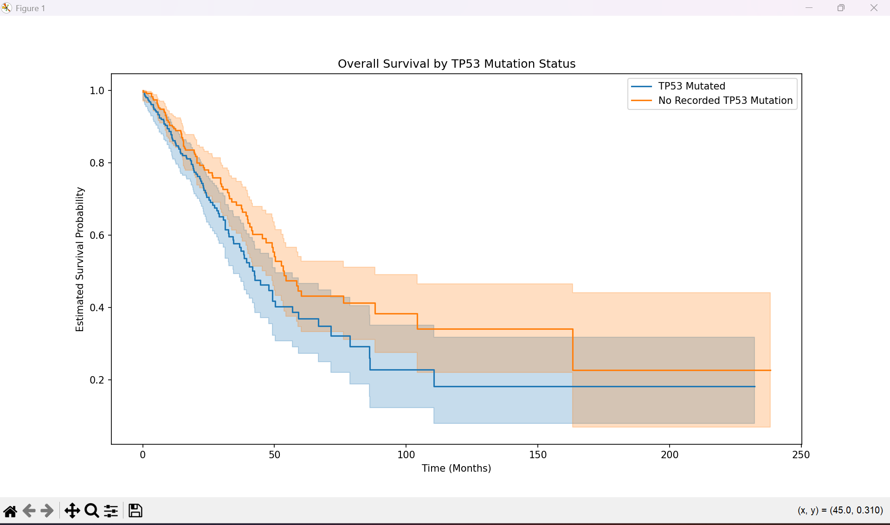
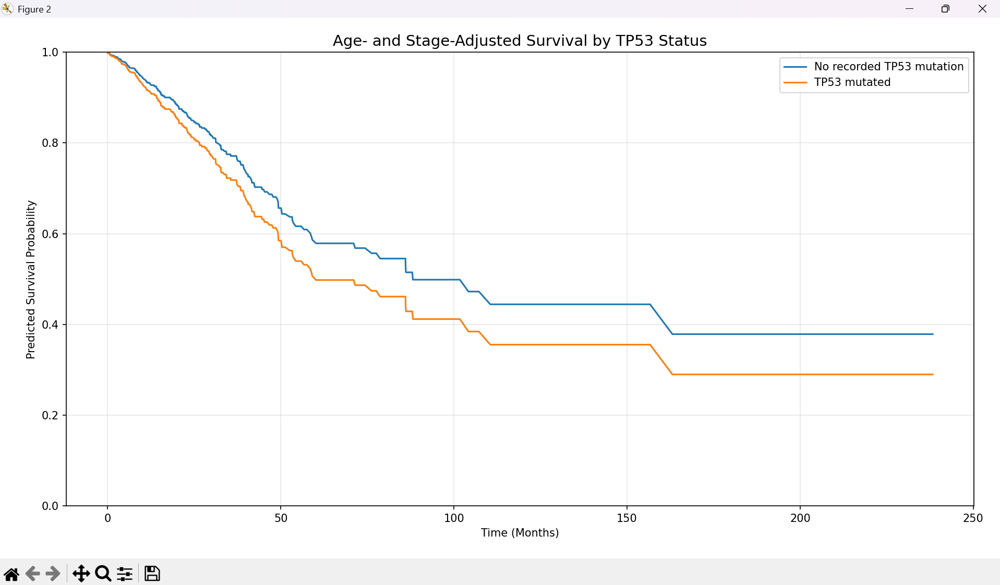

# TP53 Mutations and their Correlation to Survival Rates in Lung Adenocarcinoma (LUAD)

This analyzes whether mutations in TP53 gene are related to the overall survival in patients with lung adenocarcinoma (LUAD). Utilizing the data from the TGCA PanCancer Atlas LUAD study, I studied the relationship between mutations and survival outcomes through a Python-based data analysis. I then selected TP53 as one of the most frequently mutated genes in the dataset. 

I used Pandas, Matplotlib, and the Lifelines to clean my code, merge the data, and analyze the datasets. Patient mutation records were connected to clinical information using the sample name and patient codes. They were classified according to whether they had a TP53 mutation or not. Using the Kaplan-Meier survival analysis, I estimated the survival probabilities and used the log-rank test to compare the survival between the two groups. Cox proportional hazards regression was also utilized to estimate the connection between TP53 and overall survival. 

The unadjusted Cox model showed that patients with TP53 had about 37.5% higher hazard of death than patients without it (HR = 1.375, p = 0.033). However, when I adjusted for patient age and tumour stage, the hazard ratio fell to 1.275 and was no longer statistically significant (95% Cl: 0.941-1.728, p = 0.117). This shows that the survival difference initially observed may be related to clinical factors, specifically tumour stage, than TP53 alone. 

Thus, this analysis identified a correlation between TP53 and overall survival in an unadjusted model, but these findings were not statistically significant when accounted for tumour stage and age. These findings do not prove that TP53 mutations cause low rates of survival nor do they show that TP53 has no effect.

*Kaplan-Meier curves with confidence intervals.*

*Cox-predicted curves accounting for age and stage.*

